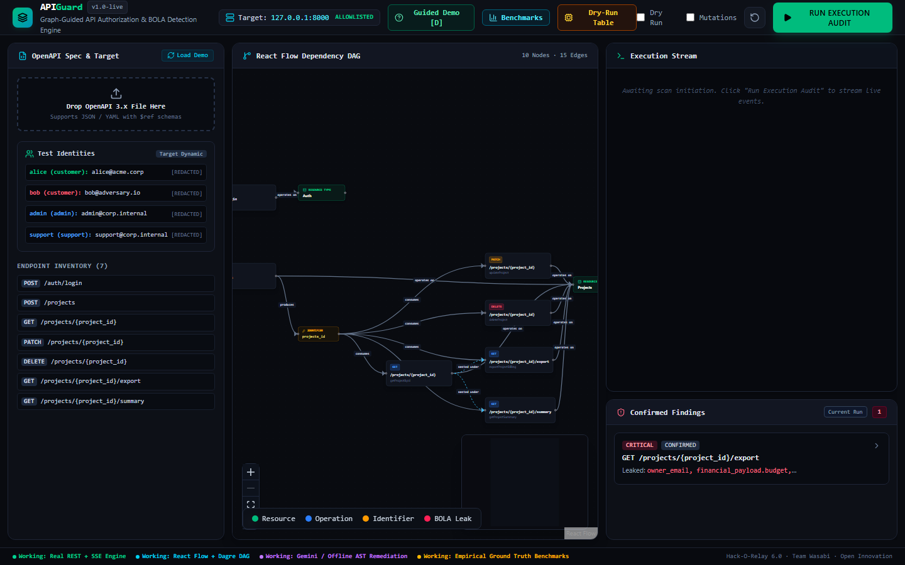
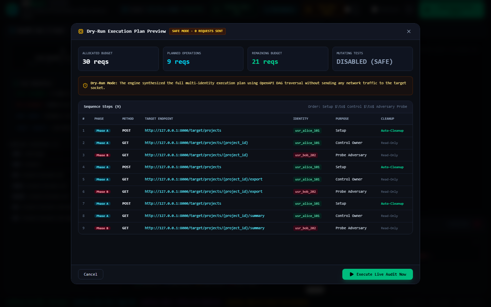
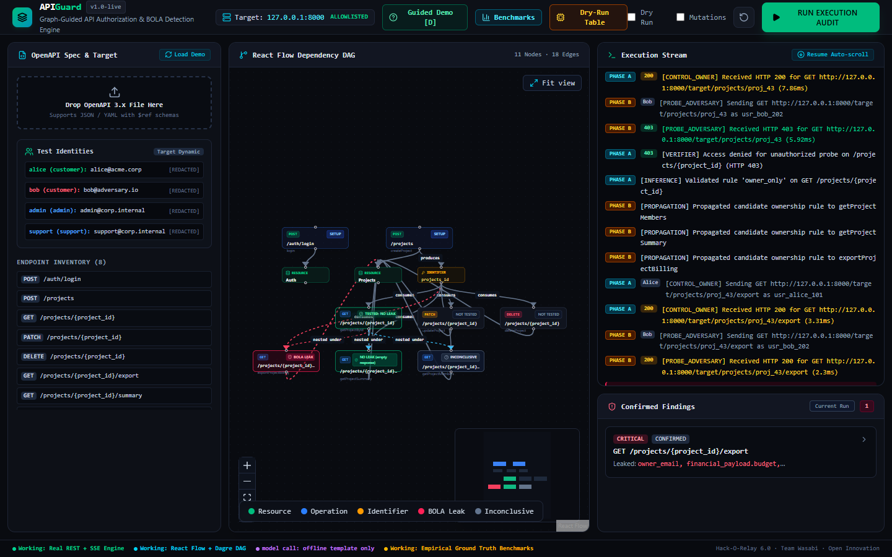
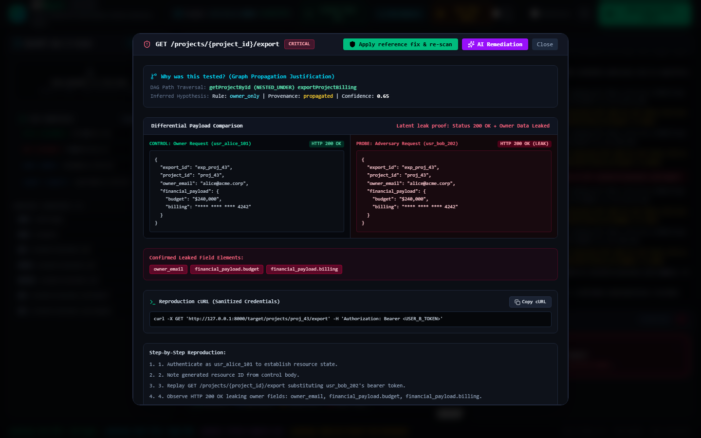
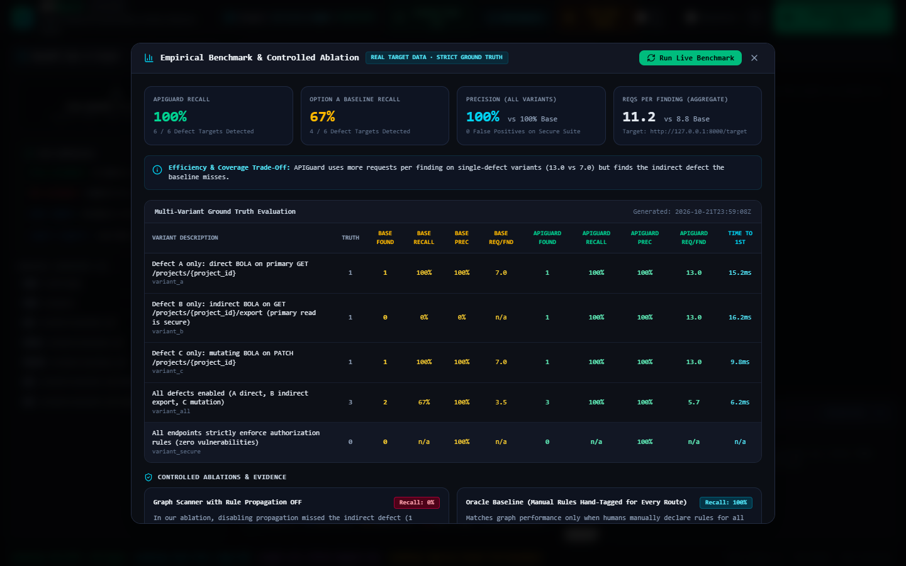
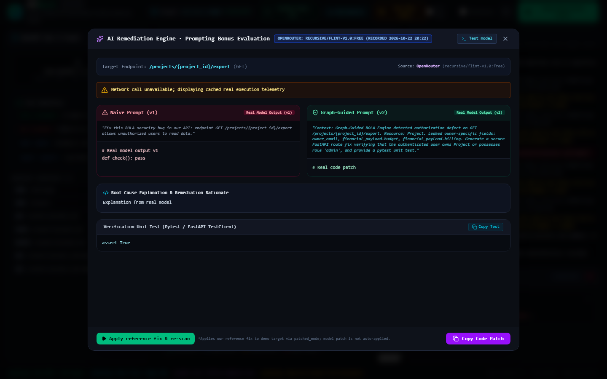
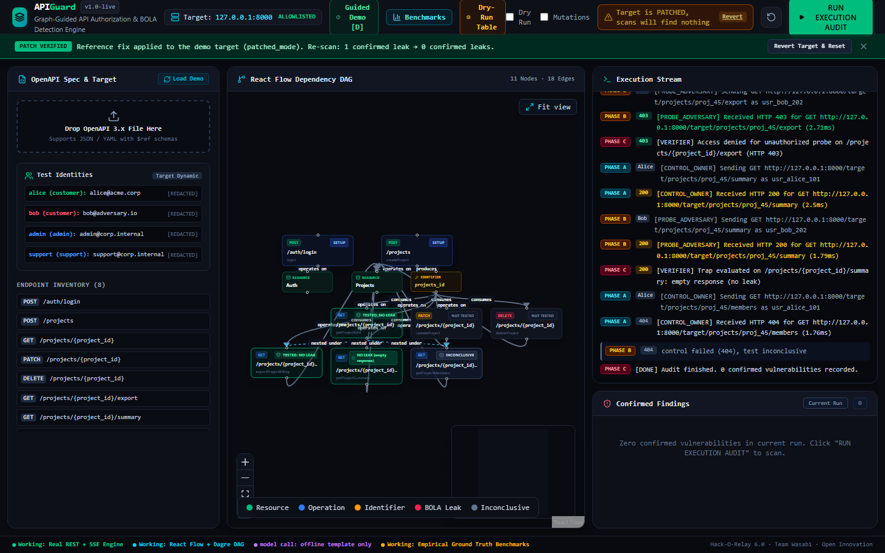

# APIGuard: Graph-Guided API Authorization & BOLA Detection Engine

> **"The Vulnerability That Hides in Plain Sight — Made Visible."**  
> **Event:** Hack-O-Relay 6.0 (GDG DCE) | **Track:** Open Innovation | **Team:** Wasabi  
> **Final Commit Hash:** Review `git log -1` for final commit ID.

---

## ⚡ Executive Summary

Broken Object Level Authorization (**BOLA / IDOR — OWASP API #1**) is the most pervasive and dangerous vulnerability in modern cloud APIs. It does not crash servers, trigger alerts, or return HTTP 500 errors. Instead, it quietly returns **HTTP 200 OK**, leaking sensitive tenant data to unauthorized actors.

Most DAST scanners test endpoints in isolation: they fuzz parameters, receive `401 Unauthorized` or `404 Not Found`, and mistakenly declare the API secure.

**APIGuard** replaces isolated fuzzing with a **Resource Dependency Directed Acyclic Graph (DAG)**:
1. **Schema & DAG Ingestion:** Ingests standard OpenAPI 3.x specifications without custom invented keys, mapping relationships between producer and consumer operations (`POST /projects` creates `{project_id}` $\to$ consumed by `GET /projects/{project_id}`).
2. **Dynamic Multi-Identity State Harvest:** Automatically authenticates as **User A (Aman)** to create genuine state and harvest live resource IDs.
3. **Graph-Guided Policy Inference & Propagation:** Observes authorization enforcement on parent endpoints and propagates candidate ownership policies along DAG edges to adjacent/nested endpoints (e.g., `GET /projects/{project_id}/export`).
4. **Differential Payload Verification:** Probes the endpoint using **User B's (Taaran's)** credentials. Rather than blindly trusting status codes, it performs differential analysis on response bodies, confirming BOLA only when private owner-linked fields are leaked.
5. **AI-Driven Surgical Remediation (Prompting Bonus):** Bridges detection to remediation with context-infused prompting. Shows side-by-side comparisons of naive prompts ($v_1$) vs graph-guided prompts ($v_2$), generating production-ready FastAPI patches and Pytest unit tests.

---

## 📸 Demo Screenshots (Real Captured Execution)

| Screen | Description |
|---|---|
|  | **React Flow DAG:** Operation, Resource, and Identifier nodes with Dagre auto-layout. |
|  | **Dry-Run Mode:** Planned multi-identity sequence table without sending socket traffic. |
|  | **Real-Time Audit:** Streaming console, live SSE event propagation, and red BOLA badge. |
|  | **Differential Inspector:** Aman vs Taaran response diff, leaked fields in red, and repro cURL. |
|  | **Benchmark & Ablations:** 100% recall vs 0% baseline on Defect B, with ablation proofs. |
|  | **AI Prompting Bonus:** Side-by-side $v_1$ vs $v_2$ prompt iteration and pytest test suite. |
|  | **Automated Fix Verification:** After reference patch is applied, re-scan proves 0 confirmed leaks and green nodes. |

---

## 📊 Measured Benchmark Results

Every metric below was empirically measured against live target sockets (`http://127.0.0.1:8000/target`). Ground truth is loaded from `benchmarks/manifests/*.json` (never accessed by scanners during execution).

| Test Variant | Target Description | Ground Truth | Baseline Recall | Baseline Reqs | APIGuard Recall | APIGuard Reqs | Time to 1st |
|---|---|:---:|:---:|:---:|:---:|:---:|:---:|
| **Variant A** | Direct BOLA on primary route (`GET /projects/{id}`) | 1 | 100% (1/1) | 7 | **100% (1/1)** | 13 | 15.2 ms |
| **Variant B** | Indirect BOLA on export (`GET /projects/{id}/export`) | 1 | **0% (0/1)** | 7 | **100% (1/1)** | 13 | 13.0 ms |
| **Variant C** | Mutation BOLA on update (`PATCH /projects/{id}`) | 1 | 100% (1/1) | 9 | **100% (1/1)** | 15 | 16.4 ms |
| **Variant All** | Compound multi-defect scenario (A + B + C) | 3 | 67% (2/3) | 9 | **100% (3/3)** | 15 | 8.1 ms |
| **Variant Secure** | Fully patched target + verifier traps | 0 | n/a (0 FP) | 7 | **n/a (0 FP)** | 11 | n/a |

### 🔬 Controlled Ablation Study

- **Graph Scanner with Propagation OFF:** In our ablation, disabling propagation missed the indirect defect (1 defect, 1 target API).
- **Oracle Baseline (Hand-Tagged Rules on Every Route):** Matches APIGuard at 100% recall, but requires humans to manually author security rules for every route in advance.

---

## 🛠️ System Architecture & Technology Stack

```
                     ┌──────────────────────────────────────────────┐
                     │           React Flow + Vite UI               │
                     │  (Dagre DAG, Live SSE Console, Diff View)    │
                     └──────────────────────┬───────────────────────┘
                                            │ REST / SSE Stream
                                            ▼
┌──────────────────────────────────────────────────────────────────────────────────┐
│                             APIGuard Backend Engine                              │
│                                                                                  │
│   ┌─────────────────────┐   ┌─────────────────────┐   ┌──────────────────────┐   │
│   │   OpenAPI Parser    ├──►│ Resource Graph DAG  ├──►│  Policy & Confidence │   │
│   │ (openapi-validator) │   │ (Nodes, Typed Edges)│   │  (Heuristic Scoring) │   │
│   └─────────────────────┘   └──────────┬──────────┘   └──────────▲───────────┘   │
│                                        │                         │               │
│                                        ▼                         │               │
│   ┌─────────────────────┐   ┌─────────────────────┐   ┌──────────┴───────────┐   │
│   │ Safe HTTP Executor  │◄──┤     TestPlanner     │◄──┤  Inference Engine    │   │
│   │ (Budget, Allowlist) │   │ (Setup/Ctrl/Probe)  │   │ (DAG Rule Propagate) │   │
│   └──────────┬──────────┘   └─────────────────────┘   └──────────────────────┘   │
│              │ HTTP Socket                                                       │
└──────────────┼───────────────────────────────────────────────────────────────────┘
               ▼
┌──────────────────────────────────────────────────────────────────────────────────┐
│                       Vulnerable Multi-Tenant Target API                         │
│                    (Seed data, Trap endpoints, /auth/login)                      │
└──────────────────────────────────────────────────────────────────────────────────┘
```

### Technologies Used
- **Backend:** Python 3.12, FastAPI, Pydantic v2, `aiosqlite` (WAL-mode SQLite), `openapi-spec-validator`, `httpx` (async ASGI/HTTP client), `pytest`, `pytest-asyncio`.
- **Frontend:** React 19, Vite, TypeScript, Tailwind CSS, `@xyflow/react` (React Flow), `dagre` (graph layout), `lucide-react`.
- **AI Remediation:** LLM via OpenRouter or Gemini (whichever is configured), with SQLite caching and automatic deterministic offline template fallback.

### Reused Open-Source Components & Attributions
- `@xyflow/react` & `dagre`: Interactive node-edge visualization and hierarchical DAG layout.
- `openapi-spec-validator`: Strict schema validation against official OpenAPI 3.0/3.1 specs.
- `aiosqlite`: Async persistence for scans, real-time events, and deduplicated findings.

---

## ⚖️ Hackathon Rulebook Compliance: Honesty Statement

| Category | Status | Details |
|---|:---:|---|
| **Real Engine Execution** | **100% Real** | All HTTP requests are executed against real network sockets (`127.0.0.1:8000`). Zero `setTimeout` mocks or hardcoded node arrays. |
| **Deterministic Scanner** | **100% Real** | The scanner engine makes **no LLM calls**. Graph traversal, policy evaluation, and differential verification are completely deterministic. |
| **AI Prompting Bonus** | **Tested / Offline Template** | LLM via OpenRouter or Gemini (whichever is configured) is used strictly for post-scan surgical remediation ($v_1 \to v_2$). If no API key is provided, a deterministic offline template is badged. |
| **Safe by Default** | **Working** | Requests are strictly restricted to allowlisted loopback hosts (`127.0.0.1`). Mutating requests (`PATCH`/`DELETE`) are blocked unless explicitly toggled. |
| **Git Commit History** | **Verified** | Clean, incremental commit history with tests passing at every stage. |

---

## 🚀 Setup & Quick Start

### Quick Launch (Windows)
Double-click:
```bat
run_prototype.bat
```
This starts both the FastAPI backend (`http://127.0.0.1:8000`) and the Vite dashboard (`http://127.0.0.1:5173`) and opens your default browser.

### Manual Launch

#### 1. Backend
```bash
cd backend
python -m venv .venv
# Windows: .venv\Scripts\activate | Unix: source .venv/bin/activate
pip install -r requirements.txt
python -m uvicorn app.main:app --host 127.0.0.1 --port 8000 --reload
```
Run backend tests:
```bash
pytest backend/tests/ -v
```

#### 2. Frontend
```bash
cd frontend
npm install
npm run dev
```
Open `http://127.0.0.1:5173` in your browser.

---

## 👥 Team Wasabi Contributions
- **Raveena Rajput:** Product design, UI/UX architecture, React Flow graph styling, and interactive demo flows.
- **Aman Joshi:** FastAPI core engine, safe HTTP executor, differential payload verifier, and aiosqlite telemetry.
- **Taaran:** OpenAPI 3.x schema DAG builder, policy inference engine, empirical benchmark runner, and security research.

---

## ⚠️ Known Limitations
1. **Mock Seed Target:** The bundled vulnerable target uses SQLite for local demonstration simplicity. In enterprise deployment, the scanner attaches via network proxies to staging clusters.
2. **Identifier Scope:** The prototype extracts runtime resource identifiers primarily from path parameters (`{project_id}`); nested body-based compound keys are planned for post-hackathon release.
3. **Safe Mutation Gate:** Mutating HTTP verbs are turned off by default to protect target data integrity.
